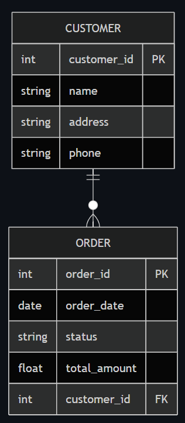
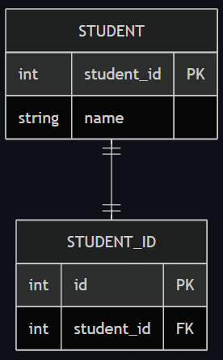
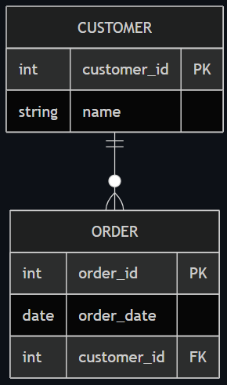
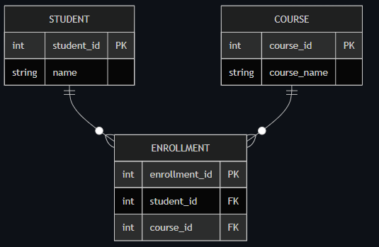
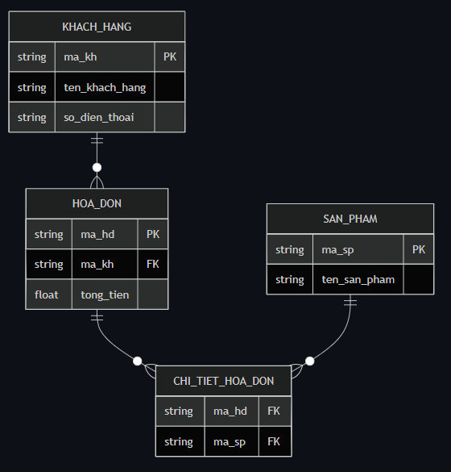
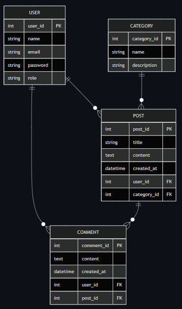
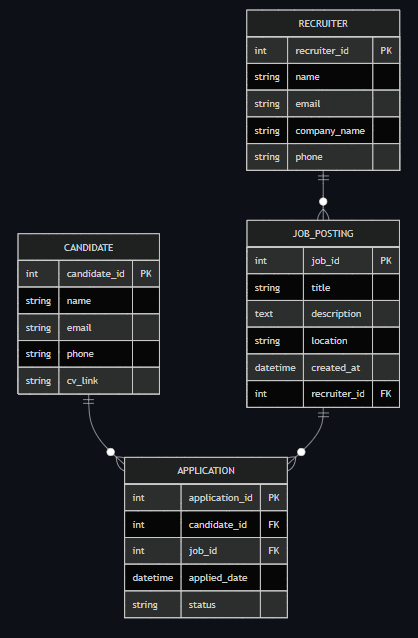

B1.

### Các thực thể và vai trò
| **Tên thực thể**                      | **Miêu tả vai trò**                                                                                                          |
| ------------------------------------- | ---------------------------------------------------------------------------------------------------------------------------- |
| **Sách**                              | Chứa thông tin chi tiết của từng cuốn sách như: mã sách, tên sách, giá, mô tả, thể loại, năm xuất bản, số lượng tồn kho.     |
| **Tác giả**                           | Lưu thông tin về người viết sách, bao gồm: mã tác giả, họ tên, tiểu sử, quốc tịch. Một tác giả có thể viết nhiều sách.       |
| **Khách hàng**                        | Lưu thông tin người mua sách: mã khách hàng, họ tên, địa chỉ, số điện thoại, email. Một khách hàng có thể có nhiều đơn hàng. |
| **Đơn hàng**                          | Đại diện cho một lần mua hàng của khách, gồm: mã đơn hàng, ngày đặt, tổng tiền, trạng thái đơn hàng, mã khách hàng.          |
| **Chi tiết đơn hàng**                 | Lưu thông tin từng sản phẩm trong một đơn hàng: mã chi tiết đơn hàng, mã đơn hàng, mã sách, số lượng, đơn giá.               |
| **Nhà xuất bản** *(tuỳ chọn mở rộng)* | Quản lý thông tin về nhà xuất bản như mã NXB, tên, địa chỉ, số điện thoại, email. Mỗi sách thuộc về một nhà xuất bản.        |

B2.

### So sánh giữa ERD và Class Diagram
| **Tiêu chí**                              | **ERD (Entity Relationship Diagram)**                                                                                                      | **Class Diagram (Sơ đồ lớp)**                                                                                                                        |
| ----------------------------------------- | ------------------------------------------------------------------------------------------------------------------------------------------ | ---------------------------------------------------------------------------------------------------------------------------------------------------- |
| **Mục đích**                              | Dùng để mô hình hóa **dữ liệu** trong hệ thống — xác định các **thực thể, thuộc tính, mối quan hệ** giữa chúng.                            | Dùng để mô hình hóa **cấu trúc và hành vi của hệ thống hướng đối tượng**, thể hiện **các lớp, thuộc tính, phương thức và mối quan hệ** giữa các lớp. |
| **Thành phần chính**                      | - Thực thể (Entity)    - Thuộc tính (Attribute)   - Mối quan hệ (Relationship)                                                       | - Lớp (Class)   - Thuộc tính (Attributes)   - Phương thức (Methods)   - Mối quan hệ (Association, Inheritance, Aggregation, Composition)    |
| **Cách biểu diễn mối quan hệ**            | - Thường dùng các đường nối giữa các thực thể với nhãn mô tả quan hệ (1–1, 1–N, N–N).   - Dạng hình học đơn giản, không có phương thức. | - Biểu diễn bằng đường nối giữa các lớp (Association, Generalization, Dependency…).   - Có thể kèm theo hướng, ký hiệu kế thừa hoặc đa hình.      |
| **Sử dụng trong giai đoạn nào của dự án** | - Giai đoạn **phân tích dữ liệu** (Database design).   - Trước khi tạo **CSDL vật lý**.                                                 | - Giai đoạn **thiết kế hệ thống hướng đối tượng (OOP)**.   - Dùng trong **phân tích và thiết kế chi tiết**.                                       |
| **Ví dụ**                                 | ERD cho **hệ thống quản lý bán sách** gồm:   `Sách`, `Tác giả`, `Khách hàng`, `Đơn hàng`, `Chi tiết đơn hàng`.                          | Class Diagram cho cùng hệ thống gồm:   `class Sach`, `class TacGia`, `class KhachHang`, `class DonHang`, có phương thức như `tinhTongTien()`.     |

B3.

B4.

### Bảng thuộc tính chi tiết
| **Entity**     | **Attribute** | **Kiểu dữ liệu**                       | **Vai trò / Ý nghĩa**                                    |
| -------------- | ------------- | -------------------------------------- | -------------------------------------------------------- |
| **User**       | user_id       | INT (PK)                               | Mã định danh duy nhất cho mỗi người dùng trong hệ thống. |
|                | full_name     | VARCHAR(100)                           | Họ và tên người dùng.                                    |
|                | email         | VARCHAR(100)                           | Địa chỉ email dùng để đăng nhập và nhận thông báo.       |
|                | role          | ENUM('student','instructor')           | Phân loại vai trò người dùng: học viên hoặc giảng viên.  |
|                | created_at    | DATETIME                               | Thời điểm tài khoản được tạo.                            |
| **Course**     | course_id     | INT (PK)                               | Mã định danh duy nhất cho mỗi khóa học.                  |
|                | course_name   | VARCHAR(150)                           | Tên khóa học.                                            |
|                | description   | TEXT                                   | Mô tả nội dung và mục tiêu khóa học.                     |
|                | instructor_id | INT (FK → User.user_id)                | Liên kết đến người giảng viên phụ trách khóa học.        |
|                | created_at    | DATETIME                               | Thời điểm khóa học được tạo trong hệ thống.              |
| **Enrollment** | enrollment_id | INT (PK)                               | Mã định danh duy nhất cho mỗi lượt đăng ký học.          |
|                | user_id       | INT (FK → User.user_id)                | Người dùng đã đăng ký khóa học.                          |
|                | course_id     | INT (FK → Course.course_id)            | Khóa học mà người dùng đăng ký.                          |
|                | enrolled_date | DATE                                   | Ngày người dùng đăng ký học.                             |
|                | status        | ENUM('active','completed','cancelled') | Trạng thái tham gia khóa học.                            |

B5.

### Tình huống 1: Một sinh viên có một mã sinh viên duy nhất

### Tình huống 2: Một khách hàng có thể đặt nhiều đơn hàng

### Tình huống 3: Một sinh viên có thể học nhiều môn học, và mỗi môn học có nhiều sinh viên

B6.

B7.

B8.

