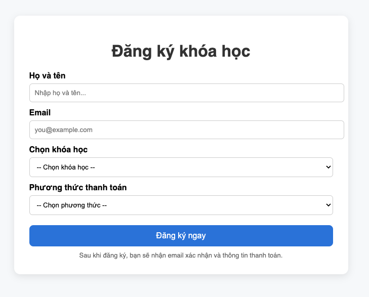

B1.

| **Yêu cầu ban đầu (mơ hồ)** | **Yêu cầu viết lại (rõ ràng)** | **Giải thích lý do** |
|------------------------------|----------------------------------|----------------------|
| Hệ thống cần thân thiện với người dùng. | Giao diện hệ thống phải có hướng dẫn thao tác rõ ràng và người dùng mới có thể hoàn thành quy trình đăng ký tài khoản trong **≤ 2 phút**. | “Thân thiện” là khái niệm trừu tượng. Phiên bản viết lại đo lường được và có thể kiểm thử qua thử nghiệm người dùng. |
| Trang web phải chạy nhanh. | Thời gian tải trang chủ **≤ 3 giây** với **1000 người dùng truy cập đồng thời**. | Có tiêu chí cụ thể về hiệu năng, có thể kiểm tra bằng công cụ benchmark. |
| Tìm kiếm cần phải tiện lợi. | Hệ thống hiển thị kết quả tìm kiếm trong **≤ 1 giây** và cho phép **lọc theo danh mục, giá, và trạng thái sản phẩm**. | Định nghĩa rõ “tiện lợi” bằng chức năng lọc và tốc độ phản hồi. |
| Ứng dụng phải bảo mật tốt. | Tài khoản người dùng phải được mã hóa bằng thuật toán **SHA-256**, có xác thực **2 bước (2FA)** khi đăng nhập. | “Bảo mật tốt” được cụ thể hóa thành tiêu chuẩn kỹ thuật có thể kiểm chứng. |
| Giao diện nên đẹp và dễ nhìn. | Tất cả trang web phải tuân thủ **chuẩn thiết kế UI/UX Material Design**, màu sắc có độ tương phản tối thiểu **4.5:1**. | “Đẹp” được lượng hóa theo tiêu chuẩn thiết kế UI/UX, có thể kiểm tra bằng công cụ đánh giá. |
| Hệ thống cần có tính linh hoạt cao. | Hệ thống cho phép **thêm module mới** mà không cần chỉnh sửa mã nguồn hiện tại, thời gian tích hợp module mới không vượt quá **2 giờ**. | “Linh hoạt” được mô tả cụ thể bằng khả năng mở rộng hệ thống và thời gian tích hợp. |
| Người dùng cảm thấy hài lòng khi sử dụng. | Sau 1 tuần thử nghiệm beta, **≥ 80% người dùng** đánh giá trải nghiệm từ **4/5 điểm trở lên** trong khảo sát phản hồi. | Biến “hài lòng” thành chỉ số đo lường được qua khảo sát định lượng. |
| Ứng dụng cần hoạt động ổn định. | Ứng dụng phải có **thời gian uptime ≥ 99.5%/tháng** và **không crash quá 1 lần/1000 phiên sử dụng**. | Xác định tiêu chí định lượng cho “ổn định”, có thể kiểm chứng bằng log và thống kê hệ thống. |

B2.

## Phần A – Giao diện người dùng

## Phần B – Thiết kế bảng cơ sở dữ liệu
## 1. Bảng `users`
| Tên cột | Kiểu dữ liệu | Mô tả | Ghi chú |
|----------|--------------|-------|---------|
| user_id | INT | Mã người dùng | **PK**, AUTO_INCREMENT |
| full_name | VARCHAR(100) | Họ và tên | NOT NULL |
| email | VARCHAR(150) | Email đăng nhập | UNIQUE, NOT NULL |
| password | VARCHAR(255) | Mật khẩu đã mã hóa | NOT NULL |
| created_at | DATETIME | Ngày tạo tài khoản | DEFAULT CURRENT_TIMESTAMP |

---

## 2. Bảng `courses`
| Tên cột | Kiểu dữ liệu | Mô tả | Ghi chú |
|----------|--------------|-------|---------|
| course_id | INT | Mã khóa học | **PK**, AUTO_INCREMENT |
| course_name | VARCHAR(150) | Tên khóa học | NOT NULL |
| description | TEXT | Mô tả chi tiết khóa học |  |
| price | DECIMAL(10,2) | Học phí |  |
| duration | INT | Số giờ học |  |
| created_at | DATETIME | Ngày tạo | DEFAULT CURRENT_TIMESTAMP |

---

## 3. Bảng `enrollments`
| Tên cột | Kiểu dữ liệu | Mô tả | Ghi chú |
|----------|--------------|-------|---------|
| enrollment_id | INT | Mã đăng ký | **PK**, AUTO_INCREMENT |
| user_id | INT | Mã người dùng đăng ký | **FK** → users.user_id |
| course_id | INT | Mã khóa học đăng ký | **FK** → courses.course_id |
| payment_method | VARCHAR(50) | Phương thức thanh toán (VNPay, Momo, Bank) |  |
| payment_status | ENUM('pending','paid','failed') | Trạng thái thanh toán | DEFAULT 'pending' |
| enrolled_at | DATETIME | Ngày đăng ký | DEFAULT CURRENT_TIMESTAMP |

---

B3.

| **Mô tả yêu cầu**                                                       | **Thuộc phần nào trong SRS**                     | **Giải thích**                                                                                                                                                               |
| ----------------------------------------------------------------------- | ------------------------------------------------ | ---------------------------------------------------------------------------------------------------------------------------------------------------------------------------- |
| **“Hệ thống hỗ trợ 5.000 user online”**                                 | **Performance Requirements (Yêu cầu hiệu năng)** | Đây là yêu cầu về **hiệu suất hoạt động**, xác định số lượng người dùng đồng thời mà hệ thống cần xử lý. Nó không mô tả chức năng cụ thể, mà là tiêu chí đánh giá hiệu năng. |
| **“Người dùng được phép xem lịch sử giao dịch”**                        | **Functional Requirements (Yêu cầu chức năng)**  | Mô tả **chức năng** mà hệ thống phải cung cấp cho người dùng (xem lịch sử giao dịch). Đây là hành vi cụ thể mà phần mềm cần thực hiện.                                       |
| **“Chức năng này cần bảo mật cấp cao”**                                 | **Security Requirements (Yêu cầu bảo mật)**      | Liên quan đến **mức độ an toàn và bảo vệ dữ liệu**. “Bảo mật cấp cao” ám chỉ yêu cầu mã hóa, xác thực nâng cao hoặc phân quyền nghiêm ngặt.                                  |
| **“Ứng dụng phải chạy được trên Chrome và Firefox”**                    | **Operating Environment (Môi trường hoạt động)** | Đề cập đến nền tảng phần mềm mà hệ thống phải tương thích — các trình duyệt cụ thể trong trường hợp này.                                                                     |
| **“Toàn bộ hệ thống được phát triển bằng Node.js và React.js”**         | **Design Constraints (Ràng buộc thiết kế)**      | Là ràng buộc về **công nghệ và framework** được yêu cầu sử dụng khi phát triển, ảnh hưởng trực tiếp đến quyết định kỹ thuật.                                                 |
| **“Giao diện trang chủ cần hiển thị danh sách khóa học nổi bật”**       | **Functional Requirements**                      | Là một **tính năng cụ thể của hệ thống** — hiển thị dữ liệu (các khóa học) cho người dùng cuối.                                                                              |
| **“Thời gian phản hồi của hệ thống không quá 2 giây cho mỗi yêu cầu”**  | **Performance Requirements**                     | Yêu cầu định lượng rõ ràng về **thời gian phản hồi (response time)** của hệ thống.                                                                                           |
| **“Tất cả dữ liệu người dùng phải được mã hóa trước khi lưu trữ”**      | **Security Requirements**                        | Mô tả yêu cầu bảo vệ dữ liệu người dùng ở mức **lưu trữ (data-at-rest)**, đảm bảo tuân thủ tiêu chuẩn an toàn thông tin.                                                     |
| **“Ứng dụng cần tương thích với cả thiết bị di động và máy tính bảng”** | **Operating Environment**                        | Yêu cầu về **tính tương thích thiết bị (device compatibility)**, thuộc nhóm môi trường hoạt động.                                                                            |
| **“Hệ thống phải tuân thủ tiêu chuẩn ISO/IEC 27001”**                   | **Design Constraints**                           | Là yêu cầu ràng buộc **chuẩn kỹ thuật và bảo mật** mà hệ thống phải tuân thủ, thuộc phần ràng buộc thiết kế.                                                                 |

B4.

| **Mục**                            | **Nội dung mô tả**                                                                                                                                                                                                                                                                                                                                                                                                                                                                                                                                                                                                                         |
| ---------------------------------- |--------------------------------------------------------------------------------------------------------------------------------------------------------------------------------------------------------------------------------------------------------------------------------------------------------------------------------------------------------------------------------------------------------------------------------------------------------------------------------------------------------------------------------------------------------------------------------------------------------------------------------------------|
| **Tên Use Case**                   | Đăng ký tài khoản (Register Account)                                                                                                                                                                                                                                                                                                                                                                                                                                                                                                                                                                                                       |
| **Actor**                          | Người dùng (User)                                                                                                                                                                                                                                                                                                                                                                                                                                                                                                                                                                                                                          |
| **Mục tiêu**                       | Cho phép người dùng tạo tài khoản mới để truy cập hệ thống học trực tuyến.                                                                                                                                                                                                                                                                                                                                                                                                                                                                                                                                                                 |
| **Điều kiện trước (Precondition)** | - Người dùng **chưa có tài khoản** trong hệ thống. - Người dùng **đang ở trang đăng ký**.                                                                                                                                                                                                                                                                                                                                                                                                                                                                                                                                               |
| **Luồng chính (Main Flow)**        | 1. Người dùng truy cập trang “Đăng ký”. 2. Hệ thống hiển thị form gồm các trường: Họ tên, Email, Mật khẩu, Xác nhận mật khẩu. 3. Người dùng nhập thông tin hợp lệ vào tất cả trường bắt buộc. 4. Người dùng nhấn nút **“Đăng ký”**. 5. Hệ thống kiểm tra định dạng email, độ dài mật khẩu, và sự trùng khớp mật khẩu. 6. Hệ thống kiểm tra xem email đã tồn tại hay chưa. 7. Nếu hợp lệ, hệ thống tạo tài khoản mới và lưu thông tin vào cơ sở dữ liệu. 8. Hệ thống gửi email xác thực đến địa chỉ người dùng. 9. Hệ thống hiển thị thông báo “Đăng ký thành công. Vui lòng kiểm tra email để xác nhận tài khoản.” |
| **Ngoại lệ (Exception Flow)**      | **E1:** Người dùng nhập email sai định dạng → Hiển thị thông báo “Email không hợp lệ.”  **E2:** Mật khẩu quá ngắn (< 8 ký tự) → Hiển thị “Mật khẩu phải có ít nhất 8 ký tự.”  **E3:** Hai mật khẩu không trùng khớp → Hiển thị “Xác nhận mật khẩu không chính xác.”  **E4:** Email đã tồn tại → Hiển thị “Email này đã được đăng ký.”  **E5:** Lỗi hệ thống khi lưu dữ liệu → Hiển thị “Có lỗi xảy ra. Vui lòng thử lại sau.”                                                                                                                                                                                                  |
| **Điều kiện sau (Postcondition)**  | Tài khoản mới được lưu vào hệ thống ở trạng thái **chưa kích hoạt (inactive)**.  Người dùng nhận được **email xác thực** để kích hoạt tài khoản.                                                                                                                                                                                                                                                                                                                                                                                                                                                                                        |
| **(Tùy chọn) Ghi chú khác**        | - Người dùng phải xác thực email mới có thể đăng nhập. - Tài khoản chưa xác thực sẽ bị xóa sau **24 giờ** nếu không kích hoạt. - Trường hợp người dùng nhập trùng email nhưng chưa xác thực → hệ thống cho phép gửi lại email xác thực.                                                                                                                                                                                                                                                                                                                                                                                              |

B5.

| **Test ID** | **Mô tả Test Case**                                | **Input / Các bước thực hiện**                                                                                                                                                                                                                                                   | **Kỳ vọng (Expected Result)**                                                                                                                                    | **Kết quả (Pass/Fail)** |
| ----------- | -------------------------------------------------- |----------------------------------------------------------------------------------------------------------------------------------------------------------------------------------------------------------------------------------------------------------------------------------| ---------------------------------------------------------------------------------------------------------------------------------------------------------------- | ----------------------- |
| **TC-001**  | **Thay đổi mật khẩu thành công**                   | 1. Đăng nhập vào hệ thống bằng tài khoản hợp lệ. 2. Truy cập trang “Thay đổi mật khẩu”. 3. Nhập mật khẩu cũ hợp lệ (vd: `OldPass123`). 4️⃣ Nhập mật khẩu mới hợp lệ (vd: `NewPass123`). 5️⃣ Xác nhận mật khẩu mới trùng khớp (`NewPass123`). 6️⃣ Nhấn “Xác nhận”. | - Hệ thống hiển thị thông báo **“Thay đổi mật khẩu thành công.”** - Người dùng có thể đăng nhập lại bằng **mật khẩu mới**. - Mật khẩu cũ không còn hợp lệ. | *(Điền sau khi test)*   |
| **TC-002**  | **Nhập sai mật khẩu cũ**                           | 1. Đăng nhập vào hệ thống. 2. Truy cập trang “Thay đổi mật khẩu”. 3. Nhập **mật khẩu cũ không đúng** (vd: `WrongOld123`). 4️⃣ Nhập mật khẩu mới hợp lệ (`NewPass123`). 5️⃣ Xác nhận trùng khớp (`NewPass123`). 6️⃣ Nhấn “Xác nhận”.                               | - Hệ thống hiển thị thông báo lỗi **“Mật khẩu cũ không chính xác.”** - Không thay đổi dữ liệu trong hệ thống. - Mật khẩu đăng nhập cũ vẫn hợp lệ.          | *(Điền sau khi test)*   |
| **TC-003**  | **Xác nhận mật khẩu mới không trùng khớp**         | 1. Đăng nhập vào hệ thống. 2. Truy cập trang “Thay đổi mật khẩu”. 3. Nhập mật khẩu cũ hợp lệ (`OldPass123`). 4️⃣ Nhập mật khẩu mới (`NewPass123`). 5️⃣ Nhập xác nhận mật khẩu khác (`NewPass124`). 6️⃣ Nhấn “Xác nhận”.                                           | - Hệ thống hiển thị cảnh báo **“Mật khẩu xác nhận không khớp.”** - Không cập nhật mật khẩu.                                                                   | *(Điền sau khi test)*   |
| **TC-004**  | **Bỏ trống trường mật khẩu mới**                   | 1. Đăng nhập vào hệ thống. 2. Truy cập trang “Thay đổi mật khẩu”. 3. Nhập mật khẩu cũ (`OldPass123`). 4️⃣ Để trống trường mật khẩu mới và xác nhận mật khẩu. 5️⃣ Nhấn “Xác nhận”.                                                                                    | - Hệ thống hiển thị lỗi **“Vui lòng nhập mật khẩu mới.”** - Không thay đổi dữ liệu.                                                                           | *(Điền sau khi test)*   |
| **TC-005**  | **Mật khẩu mới không đủ độ dài hoặc không hợp lệ** | 1. Đăng nhập vào hệ thống. 2. Nhập mật khẩu cũ hợp lệ (`OldPass123`). 3. Nhập mật khẩu mới **ngắn hơn 8 ký tự hoặc không có số/chữ in hoa** (vd: `abc123`). 4️⃣ Xác nhận lại giống nhau (`abc123`). 5️⃣ Nhấn “Xác nhận”.                                             | - Hệ thống hiển thị thông báo **“Mật khẩu mới phải có ít nhất 8 ký tự, gồm chữ và số.”** - Không cập nhật mật khẩu.                                           | *(Điền sau khi test)*   |

B6.

| **Tiêu chí**                                     | **Nội dung trả lời**                                                                                                                                                                                                                                                                                                                                                         |
| ------------------------------------------------ | ---------------------------------------------------------------------------------------------------------------------------------------------------------------------------------------------------------------------------------------------------------------------------------------------------------------------------------------------------------------------------- |
| **1. Điểm chưa rõ trong yêu cầu**                | - Không định nghĩa rõ “trải nghiệm tốt” là gì (tốc độ, độ chính xác, giao diện hay cảm nhận tổng thể?). - Thiếu tiêu chí đo lường: thế nào là “tốt”? - Không mô tả hành vi cụ thể của hệ thống.                                                                                                                                                                        |
| **2. Vì sao chưa đạt chuẩn SRS**                 | - Yêu cầu này **mơ hồ, không định lượng** và không thể kiểm thử. - SRS cần mô tả **"WHAT"** – hệ thống làm gì, chứ không mô tả cảm nhận người dùng. - Không có tiêu chuẩn đánh giá khách quan, nên không thể dùng làm căn cứ nghiệm thu.                                                                                                                               |
| **3. Cách viết lại rõ ràng hơn (đo lường được)** |  **Đề xuất 1:** “Trang tìm kiếm phải trả kết quả trong vòng **2 giây** với **1000 người dùng đồng thời**.”  **Đề xuất 2:** “Khi người dùng nhập từ khóa, hệ thống hiển thị **tối thiểu 5 kết quả phù hợp nhất** trong vòng **2 giây**.”  **Đề xuất 3:** “Tỷ lệ người dùng tìm thấy kết quả mong muốn sau lần tìm đầu tiên đạt **≥ 85%** (đo bằng khảo sát hoặc logs).” |
| **4. Có thể kiểm thử như thế nào**               | - **Kiểm thử hiệu năng:** Dùng công cụ như JMeter, k6 để đo thời gian phản hồi trung bình và tải đồng thời. - **Kiểm thử chức năng:** Thực hiện nhập từ khóa hợp lệ và không hợp lệ để xem hệ thống phản hồi có đúng yêu cầu. - **Khảo sát người dùng:** Thu thập phản hồi sau khi sử dụng tính năng tìm kiếm để đo trải nghiệm thực tế.                               |

B7.

##  HỆ THỐNG HỌC TRỰC TUYẾN (E-LEARNING SYSTEM)

### 1. Hiệu năng (Performance)
- **Mô tả:** Hệ thống phải xử lý và tải trang trong **≤ 2 giây** cho các thao tác như xem bài học, làm quiz, hoặc nộp bài tập.
- **Tiêu chí kiểm thử:** Dùng công cụ Lighthouse hoặc JMeter để đo thời gian phản hồi trung bình khi có 1000 người dùng truy cập đồng thời.
- **Kỳ vọng:** Thời gian phản hồi trung bình ≤ 2 giây.

---

### 2. Tính sẵn sàng (Availability)
- **Mô tả:** Hệ thống học trực tuyến phải duy trì mức **sẵn sàng hoạt động 99.5%** mỗi tháng.
- **Tiêu chí kiểm thử:** Theo dõi uptime qua công cụ giám sát (như UptimeRobot hoặc AWS CloudWatch).
- **Kỳ vọng:** Thời gian downtime không vượt quá **3,6 giờ/tháng**.

---

### 3. Bảo mật (Security)
- **Mô tả:** Tất cả mật khẩu người dùng phải được lưu trữ bằng thuật toán **bcrypt** với ít nhất **10 vòng mã hóa (salt rounds)**.
- **Tiêu chí kiểm thử:** Kiểm tra mã nguồn hoặc cơ sở dữ liệu đảm bảo không có mật khẩu dạng plain text.
- **Kỳ vọng:** 100% mật khẩu được mã hóa trước khi lưu trữ.

---

##  HỆ THỐNG BÁN HÀNG THƯƠNG MẠI ĐIỆN TỬ (E-COMMERCE SYSTEM)

### 1. Hiệu năng (Performance)
- **Mô tả:** Trang danh mục sản phẩm phải hiển thị **ít nhất 50 sản phẩm trong ≤ 1.5 giây**.
- **Tiêu chí kiểm thử:** Dùng Postman hoặc JMeter để đo thời gian phản hồi API `/products`.
- **Kỳ vọng:** 95% các lần tải trang có thời gian phản hồi ≤ 1.5 giây.

---

### 2. Bảo mật (Security)
- **Mô tả:** Hệ thống thanh toán phải tuân thủ tiêu chuẩn **PCI DSS**, đảm bảo mã hóa dữ liệu thẻ thanh toán bằng **SSL/TLS 1.3**.
- **Tiêu chí kiểm thử:** Kiểm tra chứng chỉ SSL và xác nhận dữ liệu thẻ không được log hoặc lưu trữ không mã hóa.
- **Kỳ vọng:** 100% giao dịch diễn ra qua kết nối HTTPS bảo mật.

---

### 3. Khả năng mở rộng (Scalability)
- **Mô tả:** Hệ thống phải có khả năng mở rộng để hỗ trợ **tối thiểu 10.000 người dùng đồng thời** mà không giảm hiệu năng quá 20%.
- **Tiêu chí kiểm thử:** Kiểm tra bằng stress test trên AWS/GCP, đo thời gian phản hồi và tỷ lệ lỗi khi tăng tải dần.
- **Kỳ vọng:** Hệ thống vẫn hoạt động ổn định, CPU sử dụng ≤ 80%.

---

B8.

## Yêu cầu chức năng
| Mã yêu cầu | Mô tả yêu cầu chức năng                                                                           | Loại       |
| ---------- | ------------------------------------------------------------------------------------------------- | ---------- |
| **FR-01**  | Hệ thống cho phép người học xem lại kết quả quiz sau khi hoàn thành bài làm.                      | Functional |
| **FR-02**  | Hệ thống hiển thị điểm số, thời gian làm bài, và trạng thái đúng/sai của từng câu hỏi.            | Functional |
| **FR-03**  | Hệ thống hiển thị đáp án đúng cho các câu người học trả lời sai.                                  | Functional |
| **FR-04**  | Người học chỉ có thể xem kết quả của **quiz mà họ đã hoàn thành**.                                | Functional |
| **FR-05**  | Hệ thống đảm bảo dữ liệu điểm và câu trả lời được lưu trữ và tải chính xác khi người học xem lại. | Functional |

## Use Case: "Xem lại kết quả quiz"
| **Mục**                                 | **Nội dung mô tả**                                                                                                                                                                                                                                                                                                                                                       |
| --------------------------------------- |--------------------------------------------------------------------------------------------------------------------------------------------------------------------------------------------------------------------------------------------------------------------------------------------------------------------------------------------------------------------------|
| **Tên Use Case**                        | Xem lại kết quả quiz                                                                                                                                                                                                                                                                                                                                                     |
| **Mã Use Case**                         | UC-01                                                                                                                                                                                                                                                                                                                                                                    |
| **Actor**                               | Người học (Student)                                                                                                                                                                                                                                                                                                                                                      |
| **Mục tiêu**                            | Xem lại kết quả bài quiz đã hoàn thành để hiểu sai sót và cải thiện kiến thức.                                                                                                                                                                                                                                                                                           |
| **Điều kiện tiên quyết (Precondition)** | - Người học đã đăng nhập vào hệ thống. - Người học đã hoàn thành ít nhất một bài quiz trước đó.                                                                                                                                                                                                                                                                       |
| **Luồng chính (Main Flow)**             | 1. Người học đăng nhập vào hệ thống. 2. Truy cập menu **“Lịch sử quiz”**. 3. Chọn bài quiz đã hoàn thành. 4. Hệ thống hiển thị chi tiết kết quả: điểm số, thời gian, danh sách câu hỏi. 5. Với mỗi câu hỏi, hiển thị câu trả lời của người học, đáp án đúng và trạng thái **đúng/sai**. 6. Người học có thể xem lại toàn bộ bài quiz, sau đó thoát trang. |
| **Ngoại lệ (Exception Flow)**           | - E1: Người học chưa làm quiz nào → Hệ thống hiển thị thông báo: *“Bạn chưa có bài quiz nào để xem lại.”* - E2: Lỗi tải dữ liệu → Hệ thống hiển thị thông báo *“Không thể tải kết quả quiz. Vui lòng thử lại.”*                                                                                                                                                       |
| **Điều kiện sau (Postcondition)**       | - Hệ thống hiển thị đúng thông tin kết quả quiz. - Người học có thể xem chi tiết các câu hỏi đã làm.                                                                                                                                                                                                                                                                  |
| **(Tùy chọn) Ghi chú khác**             | Có thể thêm nút **“Làm lại quiz”** để khuyến khích học viên ôn tập lại.                                                                                                                                                                                                                                                                                                  |

## Liên kết kiểm thử
| **Test ID** | **Mô tả Test**                 | **Input**                      | **Kỳ vọng**                                               |
| ----------- | ------------------------------ | ------------------------------ | --------------------------------------------------------- |
| **TC-01**   | Xem lại quiz đã hoàn thành     | Người học chọn 1 quiz đã làm   | Hệ thống hiển thị điểm, thời gian, kết quả từng câu       |
| **TC-02**   | Truy cập khi chưa làm quiz nào | Người học chưa có dữ liệu quiz | Hiển thị thông báo “Bạn chưa có bài quiz nào để xem lại.” |
| **TC-03**   | Lỗi tải dữ liệu                | Ngắt kết nối trong lúc tải     | Hiển thị lỗi “Không thể tải kết quả quiz.”                |