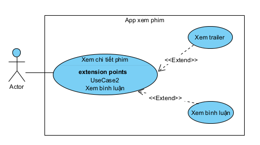
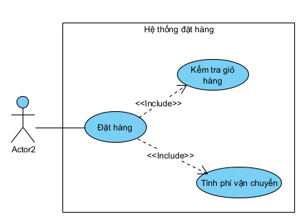
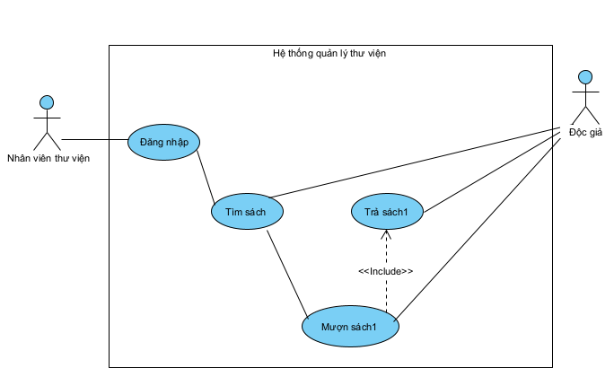
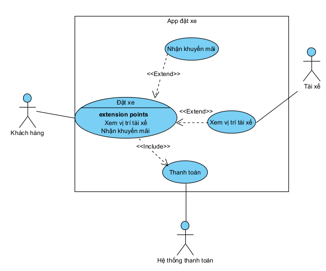
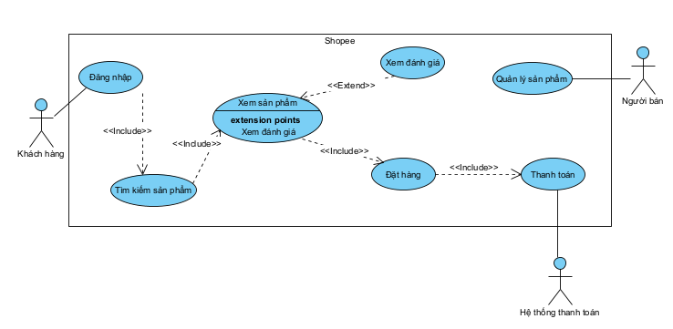

**1.** App xem phim

Mô tả:
- Hệ thống: App xem phim
- Actor: Người dùng (User / Actor)
- Use Case chính:
- Xem chi tiết phim – người dùng chọn một bộ phim và xem thông tin chi tiết.
- Use Case mở rộng:
- Xem trailer: là chức năng mở rộng khi người dùng muốn xem đoạn giới thiệu phim.
- Xem bình luận: là chức năng mở rộng khi người dùng muốn đọc các bình luận của người khác về bộ phim.

**2.** 
- Hệ thống đặt hàng

**Mô tả:**
* Hệ thống: 
* Actor: Người dùng
* Use Case chính: Đặt hàng – người dùng thực hiện quá trình đặt mua sản phẩm.
* Use Case bao gồm:
    * Kiểm tra giỏ hàng – để xác nhận sản phẩm trước khi đặt.
    * Tính phí vận chuyển – để xác định tổng chi phí đơn hàng.

---
**3.** 

   | Use Case A        | Use Case B        | Mối quan hệ   | Giải thích                                                                                                                |
   | ----------------- | ----------------- | ------------- | ------------------------------------------------------------------------------------------------------------------------- |
   | Đặt hàng          | Kiểm tra giỏ hàng |  <<include>>  | Trong quy trình đặt hàng, hệ thống luôn phải xác thực giỏ (số lượng, tồn kho, giá, mã giảm giá…) trước khi tiếp tục.      |
   | Đặt hàng          | Đề xuất hoá đơn   |  <<extend>>   | Chỉ phát sinh khi người dùng chọn **xuất hoá đơn** (VAT/hoá đơn điện tử); không phải lúc nào cũng cần trong đặt hàng.     |
   | Đặt hàng          | Xem đánh giá      | Association   | Hai chức năng độc lập về mặt luồng: người dùng có thể xem đánh giá trước hoặc không cần xem vẫn đặt hàng.                 |
   | Kiểm tra giỏ hàng | Đề xuất hoá đơn   | Association   | Không có sự phụ thuộc trực tiếp; kiểm tra giỏ diễn ra trong checkout, còn đề xuất hoá đơn chỉ bật khi người dùng yêu cầu. |

**4.** 

**5.** 

| Actor             | Loại      | Use Case phục vụ                                                                                           |
| ----------------- | --------- | ---------------------------------------------------------------------------------------------------------- |
| Khách hàng        | Primary   | Đăng ký/Đăng nhập, Tìm món ăn, Đặt món, Thanh toán đơn hàng                                                |
| Tài xế giao hàng  | Primary   | Nhận đơn giao, Xem tuyến đường giao, Cập nhật trạng thái đơn, Xác nhận giao thành công                     |
| Nhà hàng          | Primary   | Nhận và xác nhận đơn, Chuẩn bị món ăn, Cập nhật tình trạng món (hết/đổi), Xem lịch sử đơn                  |
| Quản trị hệ thống | Secondary | Quản lý người dùng (khách hàng, tài xế, nhà hàng), Quản lý đơn hàng, Xử lý khiếu nại, Xem báo cáo thống kê |

**6.** 

Tên: Đặt hàng

**Actor:** 
- Khách hàng (người dùng đặt món)
- Hệ thống (ứng dụng giao đồ ăn)

**Mục tiêu:**
Khách hàng đặt món ăn từ nhà hàng mong muốn và thanh toán đơn hàng để hệ thống xử lý và giao món đến đúng địa chỉ.

**Luồng chính:**
- Khách hàng mở ứng dụng và chọn nhà hàng muốn đặt.
- Hệ thống hiển thị danh sách món ăn của nhà hàng.
- Khách hàng chọn món ăn, số lượng, topping và thêm vào giỏ hàng.
- Khách hàng kiểm tra giỏ hàng, xác nhận địa chỉ giao hàng và phương thức thanh toán.
- Hệ thống tính tổng tiền (bao gồm phí vận chuyển và giảm giá nếu có).
- Khách hàng nhấn “Đặt hàng”.
- Hệ thống lưu thông tin đơn hàng, gửi thông báo xác nhận và chuyển đơn cho nhà hàng xử lý.

Luồng lỗi (ngoại lệ):
1. Nếu khách hàng chưa đăng nhập → Hệ thống yêu cầu đăng nhập trước khi đặt hàng.
2. Nếu món ăn đã hết hoặc nhà hàng ngừng nhận đơn → Hệ thống hiển thị thông báo lỗi và yêu cầu chọn món khác.
3. Nếu thanh toán thất bại → Hệ thống hiển thị thông báo lỗi và cho phép chọn lại phương thức thanh toán.

**7.** 

**8.** 

### **Mô tả chi tiết Use Case: "Đặt hàng"**

| **Tên Use Case**        | Đặt hàng                                                                                                                                                                     |
| ----------------------- | ---------------------------------------------------------------------------------------------------------------------------------------------------------------------------- |
| **Mô tả**               | Người dùng chọn sản phẩm, thêm vào giỏ hàng và tiến hành đặt mua.                                                                                                            |
| **Actor**               | Khách hàng                                                                                                                                                                   |
| **Điều kiện đầu vào**   | Người dùng đã đăng nhập và có sản phẩm trong giỏ hàng.                                                                                                                       |
| **Luồng sự kiện chính** | 1. Người dùng mở giỏ hàng. 2. Kiểm tra thông tin sản phẩm. 3. Nhập địa chỉ giao hàng. 4. Xác nhận đơn hàng. 5. Hệ thống thực hiện bước **Thanh toán** (include). |
| **Kết quả**             | Đơn hàng được tạo thành công, hiển thị mã đơn hàng.                                                                                                                          |
